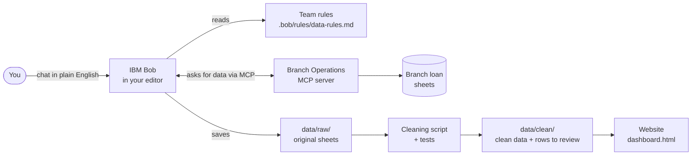
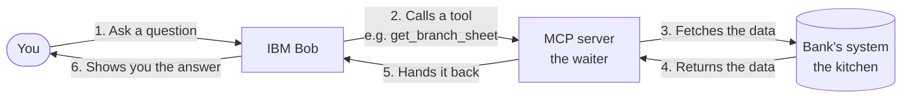

  <p align="center">
  
  &nbsp;&nbsp;&nbsp;<b>×</b>&nbsp;&nbsp;&nbsp;
  
</p>


<h3 align="center">Software Engineering Day 6.0 at Abu Dhabi University</h3>

# Exploring AI-Assisted Software Development with IBM Bob

**Time:** about 30 minutes

---

## Use Case Overview

Nujoom Bank has several branches. Every branch keeps its own spreadsheet of loan applications: who applied, for how much, and whether the loan was approved.

Once a month, these numbers are shown to the bank's managers. Last month the numbers didn't add up. Each branch typed its sheet a little differently (different date formats, spelling mistakes, the same row entered twice), so nobody could say which totals were right.

Your team has been asked to fix this. With the help of **IBM Bob**, you will:

1. **Collect** every branch's spreadsheet from the bank's system.
2. **Clean** the data, and write tests to prove the cleaning is correct.
3. **Understand** what the data says, such as which branch approves the fewest loans.
4. **Build a website** that branch managers can open to see the numbers.

You don't need to know banking or be an expert programmer. You describe what you want in plain English, Bob does the work, and you check and approve each step.

## 1. What is IBM Bob?

**IBM Bob** is an AI coding partner that lives inside your code editor. You chat with it in plain English, and it can read your project, write code, run commands and connect to other systems. You stay in control: you can review and approve what it does.

Bob has different **modes**, like different hats it can wear:

| Mode | What it does | Think of it as |
|---|---|---|
| **Ask** | Answers questions. Changes nothing. | A teacher you can ask anything |
| **Plan** | Writes a step-by-step plan before any work starts. | An architect drawing the blueprint |
| **Agent** | Writes code, creates files, runs commands. | The builder |
| **...and many more** | You can create your own modes and customise Bob for whatever you're working on. | Your own team of specialists |

## 2. Architecture Overview

This is how the pieces in this lab connect:



## 3. What Gets Checked

Your work is checked in two ways:

- **Tests:** every kind of fix in the cleaning script has a test, and all tests must pass.
- **The team rules:** nothing is guessed, the original files are never changed, and every application appears exactly once.

## 4. Prerequisites

- **IBM Bob** installed on your laptop. If you don't have it yet, download it from [bob.ibm.com/download](https://bob.ibm.com/download) and sign up using your **student email ID**.
- **Python 3.10 or newer**, to run the cleaning script and tests Bob writes.
- An **internet connection**.

---

## Step 1: Connect Bob to Branch Operations

First we create a project folder and open it in Bob. Then we connect Bob to the bank's system, so Bob can fetch the branch spreadsheets.

### 1a. Create your project folder

1. On your **Desktop**, create a new folder called **`ibm_bob_workshop`**.
2. Open **Bob**.
3. From the **File** menu, click **Open Folder...** and choose the `ibm_bob_workshop` folder you just created.

<details>
<summary><b>What is an MCP server?</b> (click to open)</summary>

<br>

Bob can only see the files inside your project folder. But the branch spreadsheets are kept on the bank's own system, not on your laptop.

An **MCP server** is like a **waiter in a restaurant**. You can't walk into the kitchen and take food yourself. Instead, the waiter gives you a menu (the list of things you can ask for), takes your order to the kitchen, and brings back your food.

In the same way, the MCP server gives Bob a "menu" of tools, such as *list the branches* or *get a branch's sheet*. Bob picks a tool, the server fetches the data from the bank's system, and hands it back to Bob.

There's nothing to install. You only tell Bob where the server is, in the next step.

</details>

### 1b. Add the server to Bob

Here is how Bob talks to the bank's system through the MCP server:



1. Open **Settings** in the Bob panel and select the **MCP** tab.
   
3. Click the **+** icon next to the search box. The **Add MCP Server** window opens.
   
5. Under **Configuration Scope**, choose your project folder, **ibm_bob_workshop** (not **Global (All Workspaces)**).
   
7. Click **Open Configuration File**. Bob opens the file `.bob/mcp.json` in your folder.
8. If the file is empty, or has only `{}` or `"mcpServers": {}`, replace its content with this:

```json
{
  "mcpServers": {
    "branch-ops": {
      "type": "streamable-http",
      "url": "https://nujoom-branch-ops.onrender.com/mcp",
      "disabled": false
    }
  }
}
```

If the file already lists other servers, keep them. Add the `branch-ops` entry inside the same `"mcpServers"` block, with a comma after the server before it:

```json
{
  "mcpServers": {
    "some-other-server": { ... },
    "branch-ops": {
      "type": "streamable-http",
      "url": "https://nujoom-branch-ops.onrender.com/mcp",
      "disabled": false
    }
  }
}
```

6. Save the file (**Ctrl+S**, or **Cmd+S** on Mac).
7. Go back to **Settings > MCP**. Find **Enable MCP tools for new tasks**. It is not switched on by default, so click it to turn it on.
8. Find `branch-ops` in the server list. Its status should show **Connected**. If it isn't listed yet, click the **refresh** icon (next to **+**) and check again.

### 1c. Check it works

Now we check which tools the server gives Bob, and make sure Bob can reach them.

1. Close **Settings** and go back to the **Bob chat**.
2. At the bottom left of the chat box, check which mode is selected. If it doesn't say **Ask** (for example, it says **Agent**, **Architect** or **Plan**), click it and select **Ask** from the menu.
   

4. Copy the prompt below into the chat box and press **Enter**:

```
Which tools does the branch-ops server give you, and what does each one do?
```
  

Bob should list tools such as `list_branches` and a tool to get each branch's sheet.

<details>
<summary><b>If it doesn't connect</b> (click to open)</summary>

<br>

| What you see | Fix |
|---|---|
| `branch-ops` not listed, or a JSON error | Check `.bob/mcp.json`: one `"mcpServers"` block, commas between servers, no comma after the last one. |
| Error or timeout on the first try | Wait a minute, then click the refresh icon (next to **+**) in **Settings > MCP**. |
| Tools listed, but Bob never uses them | Use **Ask** or **Agent** mode. |
| Still not working | Raise your hand and we will help you. |

</details>

---

## Step 2: Get the data

Now Bob uses the MCP server to download every branch's spreadsheet and save a copy in your project, exactly as the branch typed it.

**Mode: Agent**

```
Use the branch-ops server to list the branches, then get every branch's sheet.
Save each sheet unchanged as a CSV file in data/raw/, one file per branch.
```

Bob will ask for permission for each task. Click **Approve for task** for all of them.


When it's done, look in the file explorer on the left. Bob has created a folder called **`data`**, and inside it a folder called **`raw`**. Open any file in the `raw` folder. This is the data exactly as the branch typed it.

```
ibm_bob_workshop/
└── data/
    └── raw/
        └── (one CSV file per branch)
```


---

## Step 3: Write the team rules

Next we write down the rules Bob must always follow when it handles the bank's data. Bob reads these rules automatically, in every mode.

<details>
<summary><b>What are rules?</b> (click to open)</summary>

<br>

Rules are like the **rules of a shared kitchen** pinned on the fridge: "label your food", "never use someone else's ingredients", "clean up after yourself". Everyone who uses the kitchen follows them, without being told each time.

In Bob, a **rules file** works the same way. You write the rules once and keep them in the project. Every time you ask Bob for something, in any mode, it reads the rules first and follows them.

For example, if a rule says *"Never guess a missing value"*, and a row has no loan amount, Bob won't make one up. It will put the row aside for a person to review.

Banks work like this too: the rules for handling data are written once, and every developer follows them.

</details>

1. In the file explorer on the left, open the **`.bob`** folder inside `ibm_bob_workshop` (Bob created it in Step 1).
2. Inside `.bob`, create a new folder called **`rules`**.
3. Inside `rules`, create a new file called **`data-rules.md`**.

Your folder should look like this:

```
ibm_bob_workshop/
└── .bob/
    ├── mcp.json
    └── rules/
        └── data-rules.md
```


4. Paste this content into `data-rules.md` and save it:

```markdown
# Nujoom Bank data rules

These rules apply to every task in this project.

1. Never change the files in data/raw/. Write results to data/clean/.
2. Use the official branch names from the branch-ops server's list_branches tool.
3. Fix only what can be fixed safely: spellings, formats and exact duplicates.
4. Never guess. If a value is missing or doubtful, put the row in
   data/clean/rows_to_review.csv with a reason. Do not fill it in.
5. Every kind of fix must have a test, and all tests must pass.
6. Every application must appear exactly once: in the clean file or the review file.
7. Every number shown to users must come from data/clean/loan_applications.csv.
```

Check that Bob picked it up. **Mode: Ask**

```
What rules must you follow in this project?
```

---

## Step 4: Clean the data, with tests

Now we find the mistakes in the branch sheets and have Bob write a script that fixes them safely, with tests to prove it works.

> **Why clean the data? Isn't a bank's data already clean?**
> No. Real company data is typed by many people, in different places, in different ways. One branch writes `05/03/2026`, another `2026-03-05`. One types `Al Ain`, another `alain`. Some rows get entered twice.
> Computers follow the rule **"garbage in, garbage out"**: if the data going in is messy, every number coming out is wrong, no matter how good the code or the website is. That is exactly why last month's numbers didn't add up.

### 4a. Find the problems

**Mode: Ask**

```
Look at the files in data/raw/. List every data quality problem you can find,
with an example of each, and say which branch it comes from.
```

### 4b. Plan and build the cleaning

**Mode: Plan**

```
Plan a Python script that combines the files in data/raw/ and cleans them, with tests.
```

The rules file does the rest. Read the plan. Is anything being guessed? If so, tell Bob. Then approve it.

**Mode: Agent**

```
Build the cleaning script and its tests from the plan. Run the tests, then the script.
Tell me how many rows went in, how many came out clean, and how many need review.
```

---

## Step 5: Find out what the data says

With clean data, we can now ask Bob real questions and find what matters most for branch managers.

**Mode: Ask**

```
Using data/clean/loan_applications.csv, answer:
1. Which branch has the lowest approval rate, and by how much?
2. How have application numbers changed month by month?
3. Are mobile app decisions faster or slower than branch decisions?
4. What else should a branch manager know?
```

Pick the two or three findings that matter most. They go on your website.

---

## Step 6: Build the website

Now we build a one-page website that branch managers can open in their browser to see the numbers and charts.

**Mode: Plan**

```
Plan a one-page website for branch managers using data/clean/loan_applications.csv.
Show the key numbers, approval rate by branch, applications per month, and decision
times by channel. Show how many rows are still waiting for review, so managers know
the data isn't complete. It must open by double-clicking the HTML file, with no server. Give the link to open the website once its done.
```

> **Want more?** You can add your own ideas to the end of this prompt before you send it. For example: *"Add a filter by loan type"*, *"Use blue and gold colours"* or *"Add a dark mode button"*.

Read the plan and approve it. If Bob does not start building, or does not switch to **Agent** mode by itself, switch to **Agent** mode and send:

**Mode: Agent**

```
Build the website from the plan, and tell me which file to open.
```

Open it in your browser. If something looks wrong, take a screenshot of it, paste the screenshot into the Bob chat, and explain in plain words what you want changed. For example: *"The chart labels overlap. Make them readable."*

---

## 🎉 Congratulations!

You did it! In about 30 minutes, with IBM Bob, you connected to a bank's system, cleaned real-looking messy data, proved it with tests, and built a website that branch managers can use.
